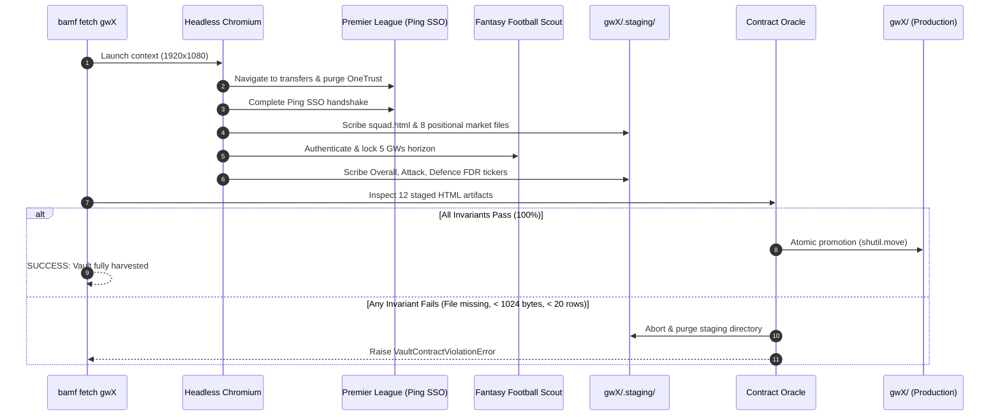

# Automated Data Ingestion and Contract Oracle (RFC-012)

### 1. The Sovereign Law
Automate multi-portal gameweek data harvesting into an isolated staging quarantine, gating production vault promotion through an independent, deterministic contract oracle enforcing complete positional hydration, row counts, and 5-week fixture dimensions to permanently eliminate look-ahead bias and manual clipboard error.

### 2. The Formulation & Trigger Context
Prior to RFC-012, data ingestion relied on the manual clipboard "Ritual of the Rip" (`bamf rip [target]`). This human-in-the-loop mechanism created three fatal failure surfaces:
1. **The Dunkirk Point Rewind (Look-Ahead Bias):** If a gameweek deadline passed without manual ripping, subsequent gameweek points (GWP) became permanently baked into cumulative Total Points (TP), contaminating historical vaults and requiring surgical name-mapped retroactive point subtraction.
2. **Ghost Hydration & Incomplete Payloads:** React client-side rendering on FPL and Fantasy Football Scout (FFS) frequently causes partial DOM hydration where tables exist with 0 rows or missing pricing headers, leading to silent solver corruptions.
3. **Multi-Portal Authentication Moats:** In 2024–2026, Premier League deprecated `users.premierleague.com` and migrated to Ping Identity OpenID Connect (OIDC) SSO on `account.premierleague.com`. Concurrently, asynchronous OneTrust cookie consent banners began injecting pointer-intercepting dark filters (`.onetrust-pc-dark-filter`, `#onetrust-banner-sdk`) 500ms after page load, occluding interactive login triggers.



### 3. Dynamic Chaos vs. Typed Mathematical Truth

| Dimension | Naive Scripting / Manual Rip (Dynamic Chaos) | Automated Ingestion & Contract Oracle (Typed Truth) |
| :--- | :--- | :--- |
| **Ingestion Trigger** | Manual copy-pasting 12 tables from browser developer tools. | Single command `bamf fetch [gwX]` or scheduled GitHub Actions cron. |
| **Authentication Flow** | Static URL posting or obsolete endpoints (`users.premierleague.com`). | Resilient OIDC Ping SSO flow with OAuth challenge URL redirects. |
| **Overlay Management** | Hard timeouts waiting for occluded elements to receive clicks. | Asynchronous `wait_for_selector` barrier + aggressive DOM purge of SDK and dark filters. |
| **Pagination Handling** | Manual navigation across Page 1 and Page 2 in UI. | Deterministic `button[aria-label='Next']` click with `button[aria-label='First']` reset. |
| **Integrity Assurance** | Trust that ripped HTML files are non-empty and well-formed. | Independent Dan Luu verification oracle gating atomic promotion. |
| **Failure Blast Radius** | Corrupts live vault directory in-place, contaminating subsequent solver runs. | Atomic staging quarantine (`gwX/.staging/`); zero promotion on violation. |

### 4. The Pattern (❌ WRONG vs. ✅ RIGHT)

**❌ WRONG (Anti-Pattern): Unvalidated In-Place Ripping & Fragile Network Waits**
```python
# FRAGILE: Waiting for networkidle hangs on persistent telemetry trackers;
# writing directly to production vault allows partially hydrated files to pollute data.
def harvest_data(gw: str):
    page.goto("https://fantasy.premierleague.com/en/transfers", wait_until="networkidle")
    # Blind click intercepted by OneTrust dark filter
    page.click("button:has-text('Log in')")
    # Directly overwriting production vault before verification
    with open(f"{gw}/squad.html", "w") as f:
        f.write(page.inner_html("table"))
```

**✅ RIGHT (Idiomatic Formulation): Asynchronous Barrier, Staged Quarantine, and Oracle Gate**
```python
# ROBUST: Neutralize async overlays, harvest into quarantine, verify contract invariants.
def execute_headless_ingestion(gameweek_dir: str, headless: bool = True) -> None:
    staging_dir = os.path.join(gameweek_dir, ".staging")
    os.makedirs(staging_dir, exist_ok=True)

    with sync_playwright() as p:
        browser = p.chromium.launch(headless=headless)
        page = browser.new_page(viewport={"width": 1920, "height": 1080})
        
        # 1. Neutralize late-injected OneTrust banner and authenticate via Ping SSO
        login_fpl(page, fpl_user, fpl_pass)
        
        # 2. Harvest into isolated staging quarantine
        harvest_fpl_squad(page, staging_dir)
        harvest_fpl_positions(page, staging_dir)
        login_ffs(page, ffs_user, ffs_pass)
        harvest_ffs_tickers(page, staging_dir)
        browser.close()

    # 3. Independent Contract Oracle Invariant Gate
    is_valid, violations = verify_vault_contract(staging_dir)
    if not is_valid:
        shutil.rmtree(staging_dir, ignore_errors=True)
        raise VaultContractViolationError(staging_dir, violations)

    # 4. Atomic Promotion to Production Vault
    for fname in os.listdir(staging_dir):
        shutil.move(os.path.join(staging_dir, fname), os.path.join(gameweek_dir, fname))
    shutil.rmtree(staging_dir, ignore_errors=True)
```
