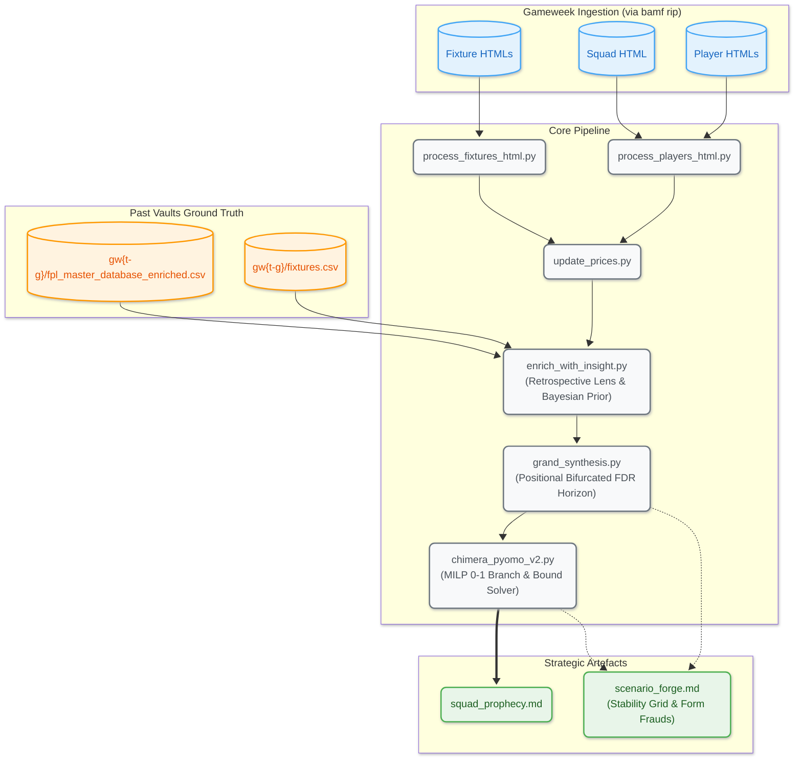
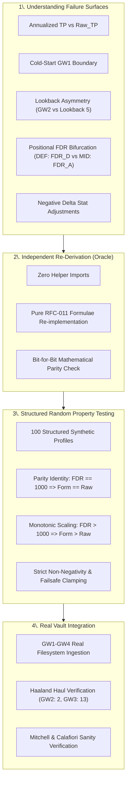

# PROJECT: BAMF DOMINATOR - OPERATIONAL GRIMOIRE (v6.0)


## MISSION STATEMENT

To systematically dismantle and dominate the Fantasy Premier League simulation by transforming raw, chaotic data into a decisive strategic advantage. This project is the home of the **Chimera**, a Python-based squad optimisation engine commanded via the `bamf` CLI. Our motto: **EX DATA, VICTORIA** (From Data, Victory).

---

## SETUP & REQUIREMENTS

To unleash the Chimera, you must first prepare the forge.

### 1. System Requirements & External Binaries

The Chimera optimization core requires a branch-and-bound MILP solver (`glpsol`), and the RIP Protocol requires system clipboard utilities across X11 and Wayland sessions.

```bash
# For Debian / Ubuntu (including 24.04 LTS / Pop!_OS)
sudo apt update && sudo apt install -y glpk-utils xclip wl-clipboard
```

- **`glpk-utils` (`glpsol`)**: The GNU Linear Programming Kit solver powering the Chimera MILP optimizations.
- **`xclip`**: X11 clipboard extraction tool.
- **`wl-clipboard` (`wl-paste`)**: Native Wayland clipboard extraction tool (standard on Ubuntu 24.04+ / GNOME Wayland).

### 2. Python Environment & Package Installation

We require **Python >= 3.10** (tested and optimized on Python 3.12 & 3.13) and use [`uv`](https://github.com/astral-sh/uv) for high-speed package management.

```bash
# 1. Install uv (if not already installed)
curl -LsSf https://astral.sh/uv/install.sh | sh

# 2. Create and activate a virtual environment
uv venv
source .venv/bin/activate

# 3. Install the project and all dependencies in editable mode
uv pip install -e .

# 4. Install Playwright browser binaries for automated headless ingestion
uv run playwright install chromium
```

### 3. Portal Credentials Configuration (.env)

For automated headless ingestion (`bamf fetch`), configure your credentials in `.env` (or via GitHub Actions secrets `FPL_LOGIN`, `FPL_PASS`, `FFS_LOGIN`, `FFS_PASS`):

```bash
FPL_LOGIN="your_fpl_email@domain.com"
FPL_PASS="your_fpl_password"
FFS_LOGIN="your_ffs_username"
FFS_PASS="your_ffs_password"
```

### 4. Advanced Shell Integration (Optimised Auto-Complete & Performance)

```bash
# Forge the Completion Artefact
_BAMF_COMPLETE=bash_source bamf > ~/.bamf-complete.bash

# Update ~/.bashrc
# 1. Load optimised auto-completion
if [ -f ~/.bamf-complete.bash ]; then
    . ~/.bamf-complete.bash
fi
# 2. Disable GIL for Pandas/Numpy performance (Python 3.13 free-threaded builds)
export PYTHON_GIL=0
```

### 5. Pre-Commit Hooks (Automated Quality Gates on Every Commit)

The project ships a `.pre-commit-config.yaml` enforcing ruff (lint + format) and ty (static type checking via `uv check`) on every commit:

```bash
# Install pre-commit via uv and activate the hooks
uv tool install pre-commit --with pre-commit-uv
pre-commit install
```

### 6. Docker & Container Deck (Zero-Setup Alternative)

To execute the entire stack without installing external solvers (`glpsol`) or Playwright browser dependencies directly on your host:

```bash
# 1. Build or pull the container
docker compose build

# 2. Execute automated headless harvest into active vault
docker compose run --rm dominator fetch gw8

# 3. Finalize prophecy via Chimera GLPK solver
docker compose run --rm dominator finalize gw8
```

---

## THE COMMAND DECK (`bamf` CLI)

All operations are channeled through our master command-line interface, `bamf`.

**Core Lifecycle & Ritual Commands:**

- `init <gwX>`: Creates a new, clean gameweek vault.
- `fetch [gwX]`: Automated Headless Ingestion via Playwright & Ping SSO with Dan Luu Contract Oracle (RFC-012).
  - `--headed / --headless`: Toggle browser GUI for live visual inspection.
  - `--storage-state <PATH>`: Load or persist browser session authentication state.
- `rip <target>`: Manual clipboard fallback into latest vault (`fix`, `fix-a`, `fix-d`, `gkp`, `gkp2`, `def`, `def2`, `mid`, `mid2`, `fwd`, `fwd2`, `squad`).
- `finalize [gwX]`: Executes the **full** end-to-end processing ritual (HTML -> CSV -> Audit -> Retrospective Lens -> MILP Solver).
- `run-gauntlet [gwX]`: Executes the core data-to-squad optimization pipeline.
- `audit`: Diagnostic suite to inspect entity resolution and data integrity (`teams`, `players`).

**Strategic Sensitivity & Reconnaissance (`bamf forge`):**

- `forge [gwX]`: Executes in-memory Scenario Forge and Temporal Gradient analysis (RFC-008 & RFC-009).
  - `--steps <N>`: Single-axis gradient interpolation from current gameweek focus to deep horizon.
  - `--model [exponential|linear|step]`: Functional decay model archetype (default: `exponential`).
  - `--param-range <start,end>`: Extrema parameter range for gradient sweep (e.g. `0.0,1.0`).
  - `--matrix`: Multi-dimensional Cartesian grid search (`decay_rates` x `form_weights`).
  - `--compare-form`: Binary audit comparing Raw Form vs Retrospective Lens to unmask **Form Frauds** and surface **Sleepers** (RFC-011).
  - `--diff-first / --full`: Noise-suppressed stability matrix filtering unchanging bench assets.
  - `--color / --no-color`: ANSI rainbow color ramps visualizing selection robustness.

**Seasonal & Specialized Tools:**

- `archive-season <tag>`: Safely packages completed gameweek vaults into `archive/<tag>/`.
- `process-set-pieces`: Synthesizes empirical corner, free kick, and penalty delivery matrices from raw HTML.
- `process-prior-season`: Decodes full-year historical performance tables to prime Bayesian priors for GW1 cold start.
- `evaluate-wildcard`: Calculates squad divergence against production solutions to trigger optimal Wildcard chips (RFC-004).

---

## SYSTEM ARCHITECTURE

The end-to-end pipeline integrates temporal discounting for future fixtures with historical fixture difficulty adjustments for past form:



---

## THE WEEKLY RITUAL (v3.0 - Automated Ingestion with Playwright & Dan Luu Contract Oracle)

This is the high-velocity, four-step workflow for the modern Carbon Pirate (π). Zero manual data entry or browser clipboard gymnastics are required.

### Step 1: Initialise the Vault
Spawn the directory structure for the upcoming campaign:
```bash
bamf init gw8
```

### Step 2: Automated Headless Ingestion (`bamf fetch` - RFC-012)
Execute fully automated ingestion across Premier League Ping SSO and Fantasy Football Scout members portal with live OneTrust overlay neutralization and Dan Luu invariant verification:
```bash
bamf fetch gw8
```
*What happens under the hood:*
1. **Quarantine:** Harvests into an isolated staging sandbox (`gw8/.staging/`).
2. **Ping SSO Handshake:** Authenticates with `account.premierleague.com` and navigates OIDC challenge redirects.
3. **OneTrust Neutralization:** Purges asynchronous pointer-intercepting cookie banners and dark filters.
4. **Multi-Page Player Market:** Navigates ARIA radiogroups and pagination to harvest Page 1 & Page 2 tables across all 4 positions.
5. **5-Week FDR Lock:** Synchronizes Fantasy Football Scout Season Ticker to the exact 5-gameweek window.
6. **Contract Oracle Verification:** Strictly verifies all 12 target artifacts before atomic promotion (`shutil.move`) into `gw8/`.

*Visual Debugging:* Add `--headed` to run with a visible browser window:
```bash
bamf fetch gw8 --headed
```

#### Optional Manual Fallback: The Ritual of the Rip (`bamf rip`)
If running without portal credentials, copy OuterHTML from browser developer tools and rip directly into the latest vault:
```bash
bamf rip fix       # Overall FDR Ticker
bamf rip fix-a     # Attack FDR Ticker
bamf rip fix-d     # Defence FDR Ticker
bamf rip gkp       # Goalkeepers table (Page 1)
bamf rip gkp2      # Goalkeepers table (Page 2)
bamf rip def       # Defenders table (Page 1)
bamf rip def2      # Defenders table (Page 2)
bamf rip mid       # Midfielders table (Page 1)
bamf rip mid2      # Midfielders table (Page 2)
bamf rip fwd       # Forwards table (Page 1)
bamf rip fwd2      # Forwards table (Page 2)
bamf rip squad     # Current squad selling values & bank
```
### Step 3: The Scenario Reconnaissance (Sensitivity & Form Fraud Audit)
Before committing to transfers, interrogate the stability of the player pool using `bamf forge`:

1. **Unmask Form Frauds (RFC-011):**
   ```bash
   bamf forge gw4 --compare-form
   ```
   *Exposes players selected under raw form who stat-padded against weak defenses and are dropped once fixture difficulty is weighted.*

2. **Map the Survival Curves & Immortals (RFC-008 & RFC-009):**
   ```bash
   bamf forge gw4 --model exponential --steps 5
   ```
   *Reveals locked **Immortals** ($R=100\%$, e.g. Bruno Fernandes), **Horizon-Dependents**, and short-term **Pure Punts** (e.g. Erling Haaland).*

### Step 4: The Single Strike (Finalize)
Execute the complete end-to-end transformation and generate the squad prophecy:
```bash
bamf finalize gw4
```
*Executes HTML parsing, reality reconciliation, Bayesian shrinkage, Retrospective Lens FDR-weighting, and solves the sovereign MILP squad, outputting `gw4/squad_prophecy.md`.*

---

## TESTING & DEFENSIVE INVARIANTS (DAN LUU METHODOLOGY)

To guarantee the mathematical integrity of the Chimera optimization core and eradicate regression gremlins (such as Bayesian annualized prior leakage during snapshot fallbacks), the codebase enforces a rigorous testing regimen inspired by **Dan Luu's Testing Heuristics** and structured around **Polya's Problem-Solving Engine**:



### Running the Test Battery

All tests are orchestrated via Python's standard `unittest` suite executed through `uv`:

```bash
# Execute entire test crucible (Chimera, Scenario Forge, Temporal Decay, Retrospective Lens)
uv run python -m unittest discover tests

# Execute targeted Dan Luu test suite for Retrospective Lens (RFC-011)
uv run python -m unittest -v tests.test_retrospective_lens

# Enforce strict code formatting, linter quality gates, and static type safety (RFC-013)
uv run ruff check . && uv run ruff format --check . && uv check
```

---

## THE ARSENAL: FILE MANIFEST

All core package sources reside within `src/fpl_dominator/`:

- `src/fpl_dominator/bamf.py`: The master command deck and entry point.
- `src/fpl_dominator/retrospective_lens.py`: Pure historical FDR extraction and contextual efficiency calculator (RFC-011).
- `src/fpl_dominator/scenario_forge.py`: Multi-scenario in-memory MILP stability engine and Form Fraud classifier (RFC-008).
- `src/fpl_dominator/temporal_decay.py`: Functional decay weighting algorithms (exponential, linear, step) and gradient interpolators (RFC-009).
- `src/fpl_dominator/chimera_pyomo_v2.py`: The decoupled Pyomo MILP optimization core.
- `src/fpl_dominator/commander.py`: Atomic pipeline orchestrator.
- `src/fpl_dominator/enrich_with_insight.py`: Bayesian prior cold start and captaincy coefficient synthesis.
- `src/fpl_dominator/grand_synthesis.py`: Positional bifurcation and temporal fixture horizon discounting.
- `src/fpl_dominator/process_players_html.py`: High-speed HTML table parser for player rosters and squad prices.
- `src/fpl_dominator/process_fixtures_html.py`: HTML fixture ticker decoder converting RGB styles to FDR metrics.
- `src/fpl_dominator/ingest_playwright.py`: Headless browser crawler with OneTrust dismissal, Ping SSO handshake, and multi-page pagination (RFC-012).
- `src/fpl_dominator/vault_contract.py`: Deterministic contract oracle and invariant gate enforcing vault payload completeness (RFC-012).
- `src/fpl_dominator/update_prices.py`: Bank balance and selling profit tax reconciliation.
- `src/fpl_dominator/wildcard_evaluator.py`: Squad divergence analysis for optimal chip timing.

**Test Battery & Invariant Fortresses:**

- `tests/test_ingest_contract.py`: Dan Luu testing crucible and independent verification oracle for vault artifacts (RFC-012).
- `tests/test_fpl_login.py`: Dedicated live portal authentication test battery for Ping SSO and FFS members area.
- `tests/test_retrospective_lens.py`: Dan Luu-style edge cases, independent oracle, property invariants, and vault integration (RFC-011).
- `tests/test_scenario_forge.py`: Multi-scenario Cartesian and gradient matrix testing (RFC-008, RFC-009).
- `tests/test_temporal_decay.py`: Functional decay weighting algorithms and mathematical clamping tests.
- `tests/test_in_memory_solver.py`: Dan Luu independent mathematical oracle, 15-rule FPL verification, and SquadSolution structural domain properties.
- `tests/test_wildcard_evaluator.py`: Dan Luu 3-path independent mathematical oracle and WildcardEvaluationResult contract invariants (RFC-004).

**CI/CD Automation:**

- `.github/workflows/quality_gate.yml`: Push/PR quality gate enforcing ruff lint, ruff format, `uv check` (ty static types), and full test battery.
- `.github/workflows/fpl_data_ingest.yml`: Scheduled GitHub Actions workflow running automated pre-deadline crawls on Wednesdays (12:00 UTC).
- `.github/workflows/docker_publish.yml`: Automated container image build and publish to GHCR on Dockerfile or source changes.
- `.pre-commit-config.yaml`: Local pre-commit hooks for ruff (lint + format) and ty (static type checking via `uv check`).

---

## KNOWLEDGE & STRATEGIC FOUNDATIONS

- **Living Grimoire:** Compiled architectural knowledge resides in `wiki/` (symlinked from `.agents/skills/fpl-machine-studying-wiki/wiki`).
- **RFC Lifecycle Archive:** Ingested ground-truth specifications reside in `wiki/raw/specs/` (RFC-001, RFC-002, RFC-004, RFC-008, RFC-009, RFC-011).
- **Active Proposals:** In-flight RFC drafts reside in `specs/` (RFC-003, RFC-005, RFC-006, RFC-007, RFC-010, RFC-012, RFC-013).
- **Roadmap:** Consult `TODO.md` for active development sprints.
