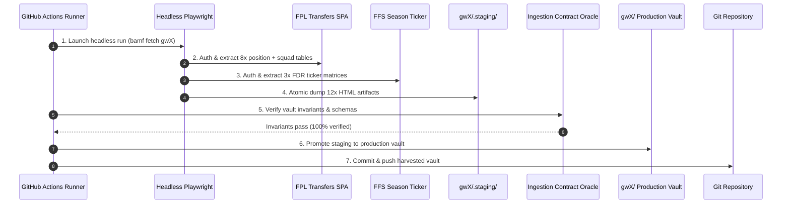
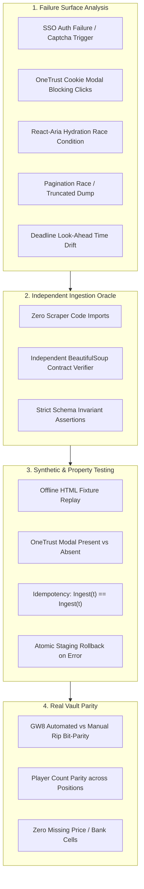

# RFC-012: Automated Headless Ingestion Pipeline (The Playwright RIP Protocol)

**Status:** DRAFT / PROPOSED `(⊕) (⇌)`  
**Target:** Replace manual clipboard ripping with automated headless Playwright scraping and GitHub Actions scheduling.  
**Core Law:** *Ingest strictly before the deadline; never contaminate historical vaults with look-ahead points.*

---

## 1. Objective & Sovereign Law

Eradicate manual data-entry friction, eliminate human latency, and permanently prevent **Look-Ahead Bias** (the "Dunkirk Point Rewind" catastrophe) by engineering an automated, headless browser pipeline using **Playwright**. 

Channelled via `bamf fetch [gwX]` and scheduled through **GitHub Actions**, this pipeline authenticates with the Fantasy Premier League (FPL) portal and the Fantasy Football Scout (FFS) members dashboard, navigates their interactive single-page application (SPA) interfaces, extracts raw outer HTML tables for all 11 required data artefacts, and commits them to the target Gameweek vault before deadline lock.

---

## 2. The Context: The "Dunkirk" Anti-Gambit

As formalized in `wiki/concepts/Data-Integrity-and-Point-Rewind.md`:
- **The Failure Mode:** When data ingestion is performed post-deadline (or lazily delayed), the FPL transfer tables reflect post-match cumulative metrics. Ingesting these values into past gameweek vaults poisons historical `Total Points (TP)` with future performances, introducing look-ahead bias that fools the Chimera MILP solver.
- **The Point-Rewind Cost:** Recovering from contamination requires dangerous retro-subtraction hacks (`point-rewind-recovery.py`) that risk non-idempotent data decay.
- **The Sovereign Solution:** Automated, unattended scheduled ingestion executed **2 to 6 hours prior to every gameweek deadline**.



---

## 3. The 12 Target Artefacts & Vault Mapping

The ingestion pipeline must extract and persist exactly 12 HTML files into the target vault (`gwX/`), adhering to the contracts expected by `process_players_html.py` and `process_fixtures_html.py`:

| Target Slug | Source Portal | Artifact File | Description / Pagination |
| :--- | :--- | :--- | :--- |
| `fix` | FFS Season Ticker | `fixtures_5w.html` | Overall FDR Ticker matrix (5-week rolling horizon) |
| `fix-a` | FFS Season Ticker | `fixtures_attack_5w.html` | Attack FDR Ticker matrix (for Midfielders/Forwards) |
| `fix-d` | FFS Season Ticker | `fixtures_defence_5w.html` | Defence FDR Ticker matrix (for Goalkeepers/Defenders) |
| `gkp` | FPL Transfers | `goalkeepers.html` | Goalkeepers Page 1 (Top 30 by selected sort) |
| `gkp2` | FPL Transfers | `goalkeepers_2.html` | Goalkeepers Page 2 (Subsequent 30 - captures £4.0m backup starters) |
| `def` | FPL Transfers | `defenders.html` | Defenders Page 1 (Top 30 by selected sort) |
| `def2` | FPL Transfers | `defenders_2.html` | Defenders Page 2 (Subsequent 30) |
| `mid` | FPL Transfers | `midfielders.html` | Midfielders Page 1 (Top 30 by selected sort) |
| `mid2` | FPL Transfers | `midfielders_2.html` | Midfielders Page 2 (Subsequent 30) |
| `fwd` | FPL Transfers | `forwards.html` | Forwards Page 1 (Top 30 by selected sort) |
| `fwd2` | FPL Transfers | `forwards_2.html` | Forwards Page 2 (Subsequent 30) |
| `squad` | FPL Transfers | `squad.html` | Active Squad List view with Selling & Purchase Prices |

---

## 4. DOM Selectors & Interaction Specifications

### 4.1 FPL Portal (`https://fantasy.premierleague.com/transfers`)

#### A. Authentication Flow
- **Login Endpoint:** `https://users.premierleague.com/` (or transfers auth modal)
- **Credential Storage:** Secrets `FPL_LOGIN` and `FPL_PASS`
- **Cookie Consent Interceptor:** Premier League uses OneTrust cookie banners.
  - Banner dismiss selector: `#onetrust-accept-btn-handler` (must click if visible before interaction).
- **Form Selectors:**
  - Username input: `input#login-username, input[name="login"]`
  - Password input: `input#login-password, input[name="password"]`
  - Submit button: `button[type="submit"]`
  - Wait for navigation back to `/transfers` or presence of `#root`.

#### B. Positional Dropdown Navigation
- **Dropdown Trigger Button:**
  - Raw Recorded Path:
    `html.light-theme body.is-logged-out main#mainContent.ism div#root div._1ksll754x div.ism div.eu9oece div.eu9oec1.eu9oec0 section div.eu9oec5 div.jw51ht0 div._1nvnlp40 div._1nvnlp42 div.enaqz30 div.react-aria-Select button#react-aria7861781041-_r_2if_._1gkly0o2._1gkly0o1._1gkly0o0._1gkly0o3`
  - *Resilient Selector:* `div.react-aria-Select button[aria-haspopup="listbox"]` or `button[id^="react-aria"]`
- **Dropdown Listbox & Options:**
  - Popover container: `div[role="listbox"], [role="presentation"]`
  - Select options:
    - `"Goalkeepers"` (`div[role="option"]:has-text("Goalkeepers")`)
    - `"Defenders"` (`div[role="option"]:has-text("Defenders")`)
    - `"Midfielders"` (`div[role="option"]:has-text("Midfielders")`)
    - `"Forwards"` (`div[role="option"]:has-text("Forwards")`)

#### C. Player Tables & Multi-Page Pagination
- **Table Container & Payload:**
  - Raw Recorded Path:
    `html.light-theme body.is-logged-out main#mainContent.ism div#root div._1ksll754x div.ism div.eu9oece div.eu9oec1.eu9oec0 section div.eu9oec5 div.jw51ht0 div._1nvnlp40 div._1nvnlp49 table._1nvnlp41`
  - *Resilient Selector:* `div._1nvnlp49 table._1nvnlp41` (extract `outerHTML`).
  - Validation: Table must contain multiple `tr._1trl5ao0` rows.
- **Pagination Controls (Page 2 Ingestion for `def2`, `mid2`, `fwd2`):**
  - Pagination Container: Located below table container `div._1nvnlp49`.
  - Next page / Page 2 button selector:
    `nav[aria-label="Pagination"] button:has-text("2"), button[aria-label="Next page"]`
  - State Barrier: Wait for table re-render (network idle or row content mutation) before capturing Page 2 `outerHTML`.

#### D. Current Squad & Treasury Reality (`squad.html`)
- **List View Toggle:**
  - Raw Recorded Path:
    `html.light-theme body.is-logged-out main#mainContent.ism div#root div._1ksll754x div.ism div.eu9oece div.eu9oec1.eu9oec0 div.eu9oec4 section div.jw51ht0 div.eu9oec3 div._187da710 div._187da711 div._1zmuz70 button.ktbkv41.ktbkv40._4xqwov0`
  - *Resilient Selector:* `button.ktbkv41.ktbkv40._4xqwov0` or `button:has-text("List")`
- **Squad Table Extraction:**
  - Raw Recorded Path:
    `html.light-theme body.is-logged-out main#mainContent.ism div#root div._1ksll754x div.ism div.eu9oece div.eu9oec1.eu9oec0 div.eu9oec4 section div.jw51ht0 div.eu9oec3 div._4xqwov7 table._4xqwov8`
  - *Resilient Selector:* `div._4xqwov7 table._4xqwov8` (extract `outerHTML`).
  - Validation: Must contain selling and purchase price cells (`CP`, `SP`, `PP`) across 15 player rows.

---

### 4.2 Fantasy Football Scout Members Portal (`https://members.fantasyfootballscout.co.uk/season-ticker/`)

#### A. Authentication Flow
- **Login Endpoint:** `https://members.fantasyfootballscout.co.uk/users/sign_in`
- **Credential Storage:** Secrets `FFS_LOGIN` and `FFS_PASS`
- **Form Selectors:**
  - Username / Email: `input#user_login`
  - Password: `input#user_password`
  - Submit: `input[type="submit"][name="commit"]`
  - Wait for successful redirect back to `/season-ticker/`.

#### B. Gameweek Horizon & View Ticker Selection
- **Dropdown Control Selector:**
  - Raw Recorded Path:
    `html.wf-francoisoneregular-n4-inactive.wf-inactive body.page.js div.antialiased.bg-gray-50.dark:bg-gray-900 main.p-4.md:ml-64.h-auto.pt-20 div.section div#fpl-ticker-root div.fpl-ticker-app div.advanced-ticker div div.ticker-controls div.control-group select.control-select`
  - *Resilient Selector:* `div.ticker-controls select.control-select`
- **Ticker Extraction Protocol:**
  1. **Overall FDR (`fixtures_5w.html`):** Select view option `"All"` or `"Overall"`. Extract `div.advanced-ticker`.
  2. **Attack FDR (`fixtures_attack_5w.html`):** Select view option `"Attack"`. Extract `div.advanced-ticker`.
  3. **Defence FDR (`fixtures_defence_5w.html`):** Select view option `"Defence"`. Extract `div.advanced-ticker`.
- **Target Outer HTML Container:**
  - Raw Recorded Path:
    `html.wf-francoisoneregular-n4-inactive.wf-inactive body.page.js div.antialiased.bg-gray-50.dark:bg-gray-900 main.p-4.md:ml-64.h-auto.pt-20 div.section div#fpl-ticker-root div.fpl-ticker-app div.advanced-ticker`
  - *Resilient Selector:* `div#fpl-ticker-root div.advanced-ticker`
  - Validation: Must contain `.gw-header-btn` headers and `.team-row` elements with `.fixture-cell` elements.

---

## 5. Playwright Script Architecture (`ingest_playwright.py`)

A standalone script `src/fpl_dominator/ingest_playwright.py` (exposed via `bamf fetch <gwX>`):

```
src/fpl_dominator/
└── ingest_playwright.py
    ├── authenticate_fpl(page, username, password)
    ├── extract_fpl_tables(page, vault_dir)
    ├── authenticate_ffs(page, username, password)
    ├── extract_ffs_tickers(page, vault_dir, start_gw)
    └── verify_artefacts(vault_dir) -> bool
```

### Defensive Safeguards (Anti-Gambit Principles)
1. **Size & Sanity Thresholds:** Every dumped HTML file must exceed 1,000 bytes and parse via BeautifulSoup with non-empty row counts before being written to disk.
2. **Atomic Ingestion:** Files are written to temporary staging (`gwX/.staging/`) and moved atomically into place once all 11 files pass validation.
3. **Audit Assertion:** Directly invoke `process_players_for_gameweek()` and `create_fixture_csv_from_html()` in dry-run mode immediately following harvest.

---

## 6. GitHub Actions Workflow Blueprint

Workflow file: `.github/workflows/fpl_data_ingest.yml`

```yaml
name: Automated Gameweek Data Ingest

on:
  schedule:
    # Trigger 6 hours and 2 hours before Friday evening deadlines (adjust per Premier League fixture calendar)
    - cron: '0 12 * * 5'
    - cron: '0 16 * * 5'
  workflow_dispatch:
    inputs:
      gameweek:
        description: 'Gameweek Vault to Populate (e.g. gw8)'
        required: true
        default: 'gw8'
      auto_finalize:
        description: 'Execute bamf finalize after ingest'
        type: boolean
        default: true

jobs:
  ingest:
    runs-on: ubuntu-latest
    steps:
      - name: Checkout Codebase
        uses: actions/checkout@v4

      - name: Install System Dependencies
        run: |
          sudo apt-get update
          sudo apt-get install -y glpk-utils

      - name: Setup Python & uv
        uses: astral-sh/setup-uv@v2
        with:
          enable-cache: true

      - name: Install Project & Playwright Browsers
        run: |
          uv sync
          uv run playwright install --with-deps chromium

      - name: Execute Headless Ingestion
        env:
          FPL_LOGIN: ${{ secrets.FPL_LOGIN }}
          FPL_PASS: ${{ secrets.FPL_PASS }}
          FFS_LOGIN: ${{ secrets.FFS_LOGIN }}
          FFS_PASS: ${{ secrets.FFS_PASS }}
        run: |
          uv run python -m fpl_dominator.ingest_playwright --gw ${{ inputs.gameweek || 'auto' }}

      - name: Run Pipeline Finalize (Optional)
        if: ${{ inputs.auto_finalize }}
        run: |
          uv run bamf finalize ${{ inputs.gameweek || 'auto' }}

      - name: Commit & Push Harvested Vault
        run: |
          git config user.name "BAMF Autonomous Harvester"
          git config user.email "bot@bamf-dominator.internal"
          git add gw*/
          git diff --staged --quiet || git commit -m "chore(data): automated ingest for ${{ inputs.gameweek || 'upcoming gameweek' }}"
          git push origin master
```

---

---

## 7. Secret Management & GitHub Secrets Security Fortress

Automated browser authentication requires handling high-privilege credentials in unattended environments without risking credential leakage into git history or public CI build logs.

### 7.1 The Zero-Leak Credential Policy
- **Never Log Secrets:** Playwright scripts must never dump request headers, login form POST payloads, or URLs with authentication query tokens to `stdout` or `stderr`.
- **Sanitized Trace & Failure Artifacts:** On scraper failure, Playwright error screenshots must be restricted to DOM elements outside password input fields, or stored in private workflow artifact bundles that expire after 48 hours.
- **Strict Git-Ignored Local Baseline:** Local development strictly sources credentials from `.env` (enforced by root `.gitignore`).

### 7.2 GitHub Repository Secrets Setup
Credentials must be provisioned as GitHub Repository Secrets under `Settings > Secrets and variables > Actions > Repository secrets`:

```bash
# Provisioning via GitHub CLI (gh)
gh secret set FPL_LOGIN -b "your_fpl_email@domain.com"
gh secret set FPL_PASS -b "your_fpl_password"
gh secret set FFS_LOGIN -b "your_ffs_username"
gh secret set FFS_PASS -b "your_ffs_password"
```

### 7.3 Session State Caching (Anti-Bot & Rate-Limit Shield)
Repeated logins from cloud runner IPs (GitHub Actions runners) can trigger bot defense heuristics or temporary IP blocks.
- **Storage State Persistence:** Playwright supports exporting authenticated browser context cookies and local storage via `context.storage_state(path="auth_state.json")`.
- **Runner Cache Integration:** The GitHub Actions workflow can cache `~/.cache/fpl_auth/` across runs. If the session cookies remain valid, the runner skips the login form entirely and navigates straight to the transfers and ticker portals.

---

## 8. Testing & Defensive Invariants (Dan Luu Methodology)

To guarantee that automated headless scraping never pollutes our data cauldron with malformed, truncated, or hallucinated tables, we establish a dedicated test battery in `tests/test_ingest_pipeline.py` adhering to **Dan Luu's Testing Heuristics**:



### 8.1 Step 1: Failure Surface Taxonomy
We systematically document every way headless scraping can catastrophically fail:
1. **The Ghost Hydration:** Playwright grabs `table._1nvnlp41` before React finishes rendering rows, dumping a shell with 0 players.
2. **The Modal Interceptor:** OneTrust or Scout promotional popups sit on a higher `z-index`, silently absorbing clicks intended for position dropdowns or pagination buttons.
3. **The Silent Desync:** Pagination click registers, but network latency delays row updates; Playwright snapshots Page 1 twice instead of Page 2.
4. **The Partial Dump Disaster:** 9 files succeed, but FFS throws a 502 on `fixtures_defence_5w.html`, leaving an incomplete vault that crashes `bamf finalize`.
5. **The Deadline Drift (Look-Ahead Poison):** Ingestion runs after matches have kicked off, dragging post-match points into historical vaults.

### 8.2 Step 2: The Independent Ingestion Oracle (`tests/test_ingest_contract.py`)
Following Dan Luu's heuristic, the test suite implements an **independent verification oracle** that does not share any helper functions, classes, or constants with `ingest_playwright.py`.

The Oracle asserts the following strict contract on any harvested vault directory (`gwX/`):
- **File Completeness Invariant:** Exactly 12 files must exist (3x fixture tickers, 8x position files including page 2s, 1x squad file).
- **Non-Triviality Invariant:** Every file size must strictly exceed $1,024$ bytes.
- **Position Row Quota:** Every positional HTML table must contain $\ge 25$ player rows (`tr._1trl5ao0`).
- **Squad Completeness:** `squad.html` must contain exactly 15 valid players with non-null `CP`, `SP`, and `PP` price structures and valid position distribution (2 GKP, 5 DEF, 5 MID, 3 FWD).
- **Fixture Matrix Dimension:** `fixtures_*.html` must resolve exactly 20 Premier League teams with 5 consecutive gameweek cells each, with FDR values strictly clamped within $[800, 1500]$.

### 8.3 Step 3: Structured Synthetic & Property-Based Testing
- **Offline HTML Mocks:** Test the scraper against saved snapshot HTML files representing:
  - Standard transfer table with OneTrust banner overlay.
  - Transfer table without banner.
  - Page 2 transitions with artificial 500ms network latency.
- **Idempotency Property Test:** Re-running the parser against identical HTML inputs produces bit-for-bit identical CSV outputs without duplicating rows or mutating index orders.
- **Atomic Rollback Assertion:** If the scraper simulates a network abort during table 10 of 12, verify that the staging directory (`gwX/.staging/`) is purged and the target vault (`gwX/`) remains untouched.

### 8.4 Step 4: Real Vault Integration & Parity Check
- Ingest `gw8` using headless Playwright and compare extracted CSVs against the manually ripped baseline files currently stored in `gw8/`.
- Ensure zero regression in player names, clubs, prices, or fixture difficulties.

---

## 9. Implementation Roadmap

1. **Phase 1: Secret Provisioning & Local Environment**
   - Configure local `.env` with `FPL_LOGIN`, `FPL_PASS`, `FFS_LOGIN`, `FFS_PASS`.
   - Provision GitHub Repository Secrets via `gh secret set`.
2. **Phase 2: Ingestion Engine Development (`src/fpl_dominator/ingest_playwright.py`)**
   - Implement authentication, cookie dismissal, dropdown navigation, multi-page pagination, and atomic staging.
   - Wire into CLI deck: `bamf fetch <gwX>`.
3. **Phase 3: Dan Luu Test Crucible (`tests/test_ingest_pipeline.py`)**
   - Implement failure surface unit tests, independent contract oracle, and synthetic HTML mocks.
4. **Phase 4: GitHub Actions Workflow Deployment**
   - Deploy `.github/workflows/fpl_data_ingest.yml` with scheduled cron and manual dispatch.
   - Run live manual test on upcoming gameweek to verify end-to-end commit-back.

*EX DATA, VICTORIA.* `(⊕) (⇌)`

