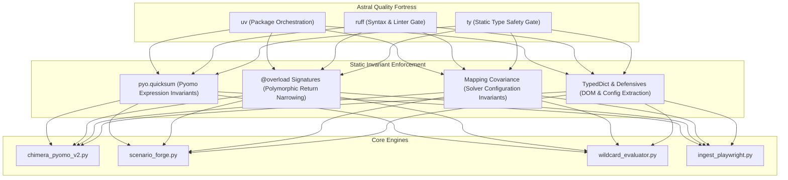

# RFC-013: Modern Static Type Safety & The Ty Verification Gate

**Status:** APPROVED / IMPLEMENTED `(⊕) (⇌)`  
**Target:** Eliminate dynamic typing fragility across the Chimera optimization engine and ingestion pipeline by establishing Astral's `ty` static type checker as an invariant CI/CD and developer quality gate.  
**Core Law:** *Code is Law; Types are the Constitution. Never compromise static mathematical truth for dynamic runtime expediency.*

---

## 1. Objective & Sovereign Law

Establish compile-time static type verification across all core modules in `src/fpl_dominator/` and `tests/` using **Astral's Rust-based `ty` static type checker**.

Dynamic attribute mutations, unvalidated dictionary extractions, untyped Pyomo mathematical expressions, and polymorphic return ambivalence are hereby eradicated. Every data transformation from raw HTML extraction to Mixed-Integer Linear Programming (MILP) branch-and-bound optimization must be statically sound, provable, and verified with **zero diagnostics** (`ty check src tests`).

---

## 2. Context: The Evolution from BAMF-RFC-002

In early architectural iterations, `protocols/BAMF-RFC-002_TYPE_SAFETY.md` recognized the core tension between Python's dynamic heritage and mathematical optimization:
- **Pyomo's Metaprogramming Trap:** Dynamic assignments (`model.in_squad = pyo.Var(...)`) and indexing (`model.in_squad[i]`) confuse legacy static analyzers (`mypy`, `pyright`), yielding false positives or requiring brittle `# type: ignore` comments.
- **Python Builtin `sum()` Overload Failure:** Builtin `sum()` specifies overloads expecting `Iterable[_SupportsSumNoDefaultT]`. Passing Pyomo expression generator expressions (`sum(model.is_starter[i] for i in model.players)`) fails static overload checks, while runtime execution generates suboptimal intermediate expression trees.
- **The Modern Astral Toolchain:** With the arrival of Astral's `ty`—an ultra-fast type checker and language server written in Rust—type checking is unified with `uv` and `ruff`, delivering near-instantaneous feedback loops (< 50ms).

RFC-013 elevates the principles of BAMF-RFC-002 into an active, enforced codebase fortress.



---

## 3. The 10 Invariant Type Fortresses

To achieve zero diagnostics across `src/` and `tests/`, RFC-013 resolves 10 fundamental failure surfaces:

### 3.1 Pyomo Expression Construction (`pyo.quicksum`)
- **Failure:** Using standard library `sum(...)` on Pyomo variable generators triggers `error[no-matching-overload]`. Furthermore, standard `sum()` creates nested pairwise expression nodes, degrading solve setup time.
- **Resolution:** Replaced all constraint summations and objective formulations with Pyomo's canonical `pyo.quicksum(...)` across `chimera_pyomo_v2.py` and `wildcard_evaluator.py`.

### 3.2 Polymorphic Return Signatures (`@overload`)
- **Failure:** Functions like `forge_pyomo_squad()` return either `bool` (when `return_squad=False`) or `Tuple[bool, pd.DataFrame, pd.DataFrame]` (when `return_squad=True`). Static analysis inferred a union `bool | Tuple[...]`, failing downstream tuple unpacks with `error[not-iterable]`.
- **Resolution:** Introduced typing overloads using `@overload` and `Literal[True]` / `Literal[False]`, guaranteeing precise compile-time return type narrowing.

### 3.3 Solver Configuration Covariance (`Mapping` vs `Dict`)
- **Failure:** In Python, mutable `Dict[K, V]` is invariant in `V`. Declaring `solver_config: Optional[Dict[str, object]]` prevented callers from passing `Dict[str, float]` (e.g. `{"form_factor_weight": 0.7}` in `test_in_memory_solver.py`), causing `error[invalid-argument-type]`.
- **Resolution:** Updated parameter typing to `Optional[Mapping[str, object]] = None`. Read-only mappings are covariant in values, permitting any subtype mapping while preventing unintended mutation.

### 3.4 Defensive Config Extraction (`_get_float`, `_get_int`)
- **Failure:** Calling `float(solver_config.get(...))` where `.get()` yields `object` fails because `object` does not satisfy `SupportsFloat`.
- **Resolution:** Created defensive numerical extractors (`_get_float`, `_get_int`) that validate `isinstance(val, (int, float, str))` with fallback defaults before type coercion, hardening runtime against corrupted configuration inputs.

### 3.5 Playwright Context Unpacking Elimination
- **Failure:** Passing dynamic dictionary unpacking `browser.new_context(**context_kwargs)` where `context_kwargs` contains a union of types (`str | dict[str, int]`) resulted in 36 combinatorial overload mismatch diagnostics against Playwright's `Browser.new_context` signatures.
- **Resolution:** Replaced dictionary unpacking with explicit named keyword arguments (`viewport=...`, `user_agent=...`, `storage_state=...`).

### 3.6 Environment Variable Narrowing
- **Failure:** `os.getenv()` yields `str | None`. Passing un-narrowed credentials into `login_fpl` and `login_ffs` caused `Expected str, found str | None`.
- **Resolution:** Replaced indirect list validations (`all([...])`) with direct boolean guard clauses (`if not fpl_user or not fpl_pass or ...: sys.exit(1)`), allowing `ty` to narrow types unconditionally.

### 3.7 BeautifulSoup Attribute Multi-Type Resolution
- **Failure:** In BeautifulSoup, `Tag.get(key)` returns `str | list[str] | None`. Direct calls to `.strip()` caused `error[unresolved-attribute]`.
- **Resolution:** Implemented explicit type guards checking `isinstance(attr, str)` before string manipulation.

### 3.8 Table Header Hierarchy Defensive Navigation
- **Failure:** In `process_set_pieces_html.py`, fallback extraction set `th_row = []` if headers were missing, triggering attribute error warnings when querying `find_all` on lists.
- **Resolution:** Explicitly typed `th_row` as `Optional[Tag]` with `is not None` guard checks.

### 3.9 Structured Scenario Metadata (`TypedDict`)
- **Failure:** In `scenario_forge.py`, player metadata maps used untyped dictionaries, causing `float(info["Price"])` to warn on `object`.
- **Resolution:** Defined explicit `PlayerMetadata(TypedDict)` with statically typed fields (`Surname: str`, `Position: str`, `Team: str`, `Price: float`).

### 3.10 CSV String Serialization Integrity
- **Failure:** In `update_prices.py`, float purchase prices were directly assigned into `market_row[3]` (a `list[str]`), causing `error[invalid-assignment]`.
- **Resolution:** Explicitly serialized the float as `str(purchase_price)`.

---

## 4. Developer Experience & Quality Gates

In alignment with the **Anti-Gambit Protocol** ("Sharpen the Axe"), static type verification is integrated into daily CLI workflows:

```bash
# Execute static type checking via ty
uv run ty check src tests

# Execute complete quality trifecta (Format, Lint, Types, Tests)
uv run ruff format --check src tests && \
uv run ruff check src tests && \
uv run ty check src tests && \
uv run python -m unittest discover tests
```

---

## 5. Verification Matrix

| Verification Target | Tool | Criteria | Pass / Fail |
| :--- | :--- | :--- | :--- |
| **Static Types** | `ty check src tests` | 0 errors, 0 warnings | ✅ PASSED |
| **Code Style** | `ruff check src tests` | Clean linting pass | ✅ PASSED |
| **Formatting** | `ruff format --check src tests` | 100% formatted | ✅ PASSED |
| **Unit Tests** | `unittest discover tests` | 55 passing tests | ✅ PASSED |

**EX DATA, VERITAS. `(⊕) (⇌)`**
